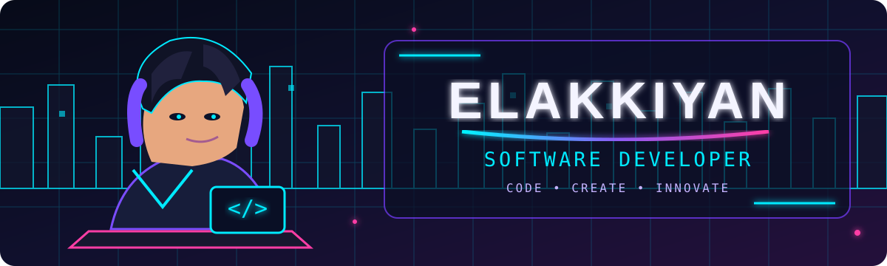

<div align="center">




</div>

---

<table>
<tr>
<td width="58%" valign="top">

## <span style="color:#00F5FF">◈ ABOUT ME</span>

**Hey, I'm Elakkiyan** — an aspiring software developer who enjoys coding, learning new technologies, and building projects.

```text
[ USER      ]  ELAKKIYAN
[ ROLE      ]  ASPIRING SOFTWARE DEVELOPER
[ STATUS    ]  LEARNING / BUILDING
[ MISSION   ]  TURN IDEAS INTO CODE
```

- 💻 Building real-world projects
- 🧩 Practicing problem-solving through coding
- 🚀 Exploring software development
- 🎯 Constantly learning and improving

</td>
<td width="42%" valign="top">

## <span style="color:#FF3EA5">◈ CURRENT FOCUS</span>

<div align="center">


<br/><br/>


<br/><br/>


</div>

</td>
</tr>
</table>

---

## <span style="color:#00F5FF">◈ TECH & TOOLS</span>

<div align="center">

<table>
<tr>
<td align="center" width="25%">
<br/><br/>

</td>
<td align="center" width="25%">
<br/><br/>

</td>
<td align="center" width="25%">
<br/><br/>

</td>
<td align="center" width="25%">
<br/><br/>

</td>
</tr>
</table>

</div>

---

## <span style="color:#FF3EA5">◈ FEATURED PROJECTS</span>

<table>
<tr>
<td width="50%" valign="top">

### <span style="color:#00F5FF">01 / SAMPLE DBMS JAVA</span>

Java and database project.

<a href="https://github.com/Elakkiyan222/SAMPLE-DBMS-JAVA-PROJECT"></a>

</td>
<td width="50%" valign="top">

### <span style="color:#FF3EA5">02 / LEETCODE</span>

Coding challenges and problem-solving practice.

<a href="https://github.com/Elakkiyan222/LEETCODE"></a>

</td>
</tr>
<tr>
<td width="50%" valign="top">

### <span style="color:#9D4EDD">03 / HTML PORTFOLIO</span>

Personal portfolio website project.

<a href="https://github.com/Elakkiyan222/html-portfolio"></a>

</td>
<td width="50%" valign="top">

### <span style="color:#00F5FF">04 / JAVA DBMS</span>

Java-based database project.

<a href="https://github.com/Elakkiyan222/java-dbms-project"></a>

</td>
</tr>
</table>

---

## <span style="color:#00F5FF">◈ GITHUB SYSTEM STATUS</span>

<div align="center">


</div>

---

## <span style="color:#FF3EA5">◈ CONTRIBUTION MATRIX</span>

<div align="center">


</div>

---

## <span style="color:#00F5FF">◈ CONNECT</span>

<div align="center">

<a href="https://github.com/Elakkiyan222"></a>
<a href="https://www.linkedin.com/in/mohan-raj-full-stack-developer/"></a>

<br/><br/>

### <span style="color:#FF3EA5">[ SYSTEM MESSAGE ]</span>

`LEARN // BUILD // REPEAT`

<em>“The future is built one line of code at a time.”</em>

</div>
